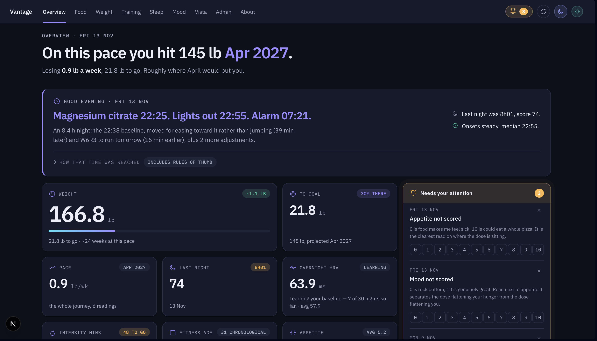
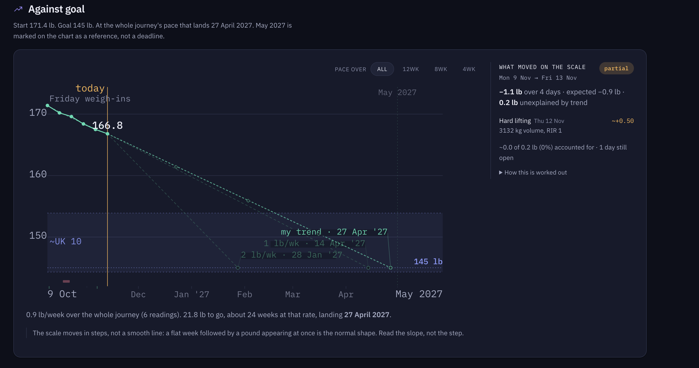
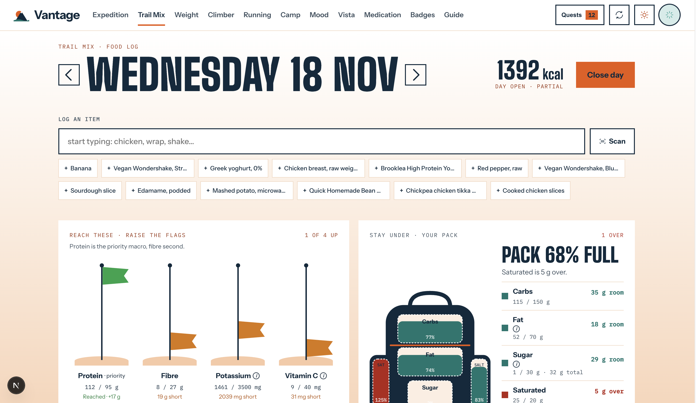
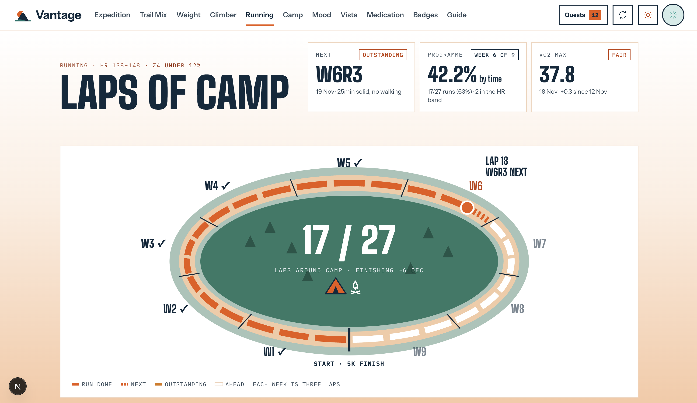
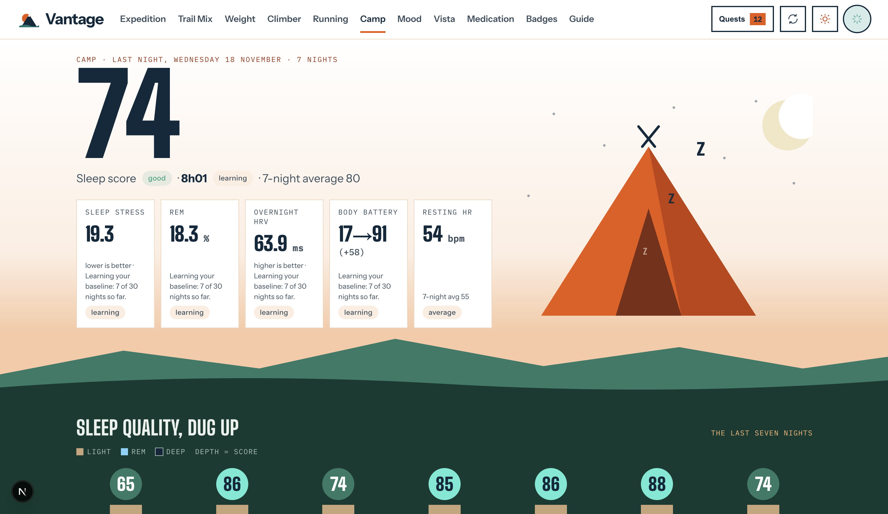

# Vantage

A self-hosted health dashboard. One SQLite file, a Next.js app over the top, and
a sync that pulls wearable data in on a timer.

It replaced a sprawl of chat logs, one-off charts and a folder of daily text
files with a single source of truth for weight, medication, training, sleep and
food — and then kept going, into the part most trackers skip: explaining *why* a
number moved.

**This repository is a showcase.** It holds screenshots and design notes. The
source is private, because the database it runs against is medical.

---

## Screenshots

### Overview

Weight against goal, pace, drug level, last night's sleep, and the scored day calendar.

### Weight

Readings against the goal line, with the card explaining what moved the latest one.

### Medication

Dose calendar, decay curve and supply projection.

### Food

Day totals with macro gauges and itemised entries.

### Training

Lifting progression per movement.

### Running

Per-session HR zones against a programme-week target.

### Sleep

Score, HRV, stress and stages for a single night.

All screenshots use a demo profile whose figures are invented.

---

## What it does

| Page | What it shows |
|---|---|
| Overview | Weight against goal, current pace, drug level in system, last night's sleep, intensity minutes, protein, and a calendar of scored days |
| Weight | Every reading against the goal line, fitted pace, and a card explaining what moved the latest one |
| Medication | Dose calendar, pharmacokinetic decay curve, supply projection, remaining stock derived rather than stored |
| Food | Day totals with macro gauges, itemised entries, barcode scanning, a searchable food bank |
| Training | Lifting progression per movement, load ladder, and a session picker that reads soreness |
| Running | Structured beginner-programme progress, per-session HR zones against a target that scales with programme week |
| Sleep | Score, HRV, sleep stress, REM, body battery, and a derived bedtime recommendation |

Multi-profile, PIN-gated, with a demo profile whose figures are invented — which
is what the screenshots above show.

---

## The interesting part

Most of the engineering here is not the UI. It is the set of rules the code
enforces to stop it producing a confident wrong answer. Every one of them exists
because an earlier version got it wrong.

**Missing is not zero.** A gap renders as "no data" in its own colour, never as
`0` or a dash. The sync log records failures per endpoint, so a successful daily
fetch cannot mask a failed sleep fetch on the same date.

**Never infer an input from its own output.** Alcohol intake is not reverse
engineered from sleep data, even though the overnight signature is obvious,
because deriving the input from the output makes the correlation circular. Where
the signature is present and the field is empty, the night is *flagged* and the
value left null — and any weekly total containing a flagged night reports itself
as a floor rather than a total.

**Stated figures never mix with computed ones.** Imported days carry
hand-written totals; itemised days compute from a food table. A view column says
which, and the UI labels the difference, because averaging the two silently
would make the series meaningless.

**An open day understates intake.** Food gets forgotten, never invented. A day
counts as closed only when the user says so, and open days are excluded from
every average.

**Two different questions, two different code paths.** "Is this reading
unusual?" and "what moved it?" live in the same module and are deliberately not
wired together. A move can be entirely explainable while sitting inside normal
variation — so gating the explanation on the anomaly flag would show nothing on
exactly the readings a person actually asks about.

**A statistical band is calibrated on comparable readings only.** Fitting
variance across a regime change mixed two populations — a short initial rapid
phase and a later settled one — and the first swamped the second, flagging an
old baseline reading while staying silent on a genuine outlier. Bounded to the
settled period, the residuals centre on zero. Below a minimum sample there is
*no band at all*, rather than a fallback to the contaminated one.

**Stated physiology is never presented as fitted.** The figures that rank
competing explanations for a weight move are published constants, not
regressions on one person's data. They render with a `~`, the UI says in its own
words that they rank rather than measure, and the note explaining what sample
size would be needed to fit them properly is itself tracked in the database.

**Some causes are deliberately absent.** Three plausible explanations for a
weight change are not offered at all, each for a stated reason: one has no
timestamp to reason from, one cannot be evidenced from the data on file, and one
would need body composition measurements the project does not have. An
explanation that cannot be supported is worse than no explanation.

**Know what the sensor actually measures.** Resistance training does not appear
in wearable data at all, because it never holds heart rate in the relevant
zones — so it is read from the lifting log, and cardio volume from intensity
minutes, never from activity count. Intensity minutes themselves come from the
vendor's activity-and-cadence method, not heart-rate zones, and conflating the
two produced a wrong analysis once already. The least trustworthy column in the
sleep data varies by more than an order of magnitude between nights; it is
displayed for completeness and never scored.

**Never guess a match.** An exact or single-candidate food match logs silently.
Multiple candidates ask. An unknown food is added to the bank first. The one
thing it will not do is pick the likeliest row and continue.

---

## Architecture

Further notes:

- [Architecture](docs/architecture.md) — data model, sync design, the view layer
- [Design decisions](docs/decisions.md) — what was built, rejected, and reversed
- [Security posture](docs/security.md) — threat model for medical data on a work machine

In short: Next.js App Router with server components, `better-sqlite3`, four npm
dependencies, and charts hand-rolled as inline SVG rather than pulling in a
charting library. A Python virtualenv handles the wearable sync. The production
deployment is Docker and a userspace Tailscale sidecar on a home server, with a
two-minute poller, verified backups and a smoke test that performs a real
authenticated write against a disposable copy of the database before promoting
a build.

Roughly 86,000 lines across the app, domain logic, 124 numbered migrations and
132 test files.

---

## Why it exists

Commercial trackers are built to be *encouraging*. That makes them bad at the
one job that matters when you are making decisions from the data: telling you
when the data does not support a conclusion.

This one is built the other way round. It will tell you a week's alcohol total
is a floor rather than a total, that an average excludes four days because they
were never closed, and that it has no opinion on a reading because there are not
enough comparable ones yet. Those answers are less satisfying and considerably
more useful.
